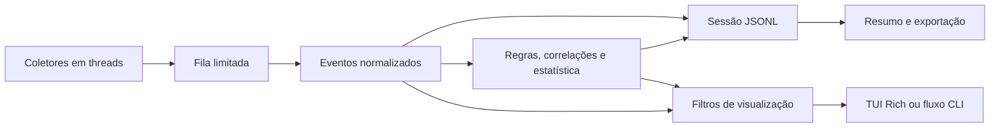

# Arquitetura

O VitaisK coleta eventos do host Linux e avalia tudo localmente. O painel e o modo em fluxo usam o mesmo motor e o mesmo formato de sessão.

## Coleta e disponibilidade

| Coletor | Origem e requisitos |
| --- | --- |
| Journal | `journalctl` e permissão para ler o journal. Pode classificar eventos de autenticação, kernel e firewall. |
| Arquivos | Syslog, autenticação, kernel ou firewall quando o arquivo correspondente existe e é legível. |
| Auditoria | `audit_log_path`, com `/var/log/audit/audit.log` como padrão. |
| Métricas | CPU, memória, disco, carga e processos via `psutil`. |
| Conexões | Amostras da tabela de conexões usando `ss`. |
| Captura contínua | Opcional, desativada por padrão. Usa `tcpdump` para amostrar TCP SYN sem ACK. |

O comando `vitaisk capture` é independente do monitor. Ele grava um PCAP sob demanda e precisa de `tcpdump` e acesso à interface.

## Processamento

- Os coletores produzem objetos `Event` com horário, origem, categoria, nível, mensagem e conteúdo original. Host, usuário, IP e porta dependem do que a origem fornece.
- A fila é limitada. Se encher, descarta o item mais antigo e incrementa o contador de perdas.
- O motor tenta reduzir duplicatas recebidas de coletores diferentes. Em seguida aplica regras pontuais, regras por contagem e sequências de dois estágios. O desvio estatístico compara taxas de erros por host e origem.
- Os filtros de exibição são aplicados após a detecção. As sessões incluem os eventos efetivamente processados, inclusive os ocultados pelo filtro.

## Dados locais

A configuração e as regras usam o diretório XDG de configuração. As sessões, a referência estatística e os PCAPs gerados no caminho padrão usam o diretório XDG de dados. Em uma instalação comum para o usuário atual, são `~/.config/vitaisk` e `~/.local/share/vitaisk`.

Sessões e capturas podem conter endereços, usuários e trechos de logs. Antes de compartilhar uma amostra, substitua esses dados e preserve apenas os campos necessários para entender o comportamento.
